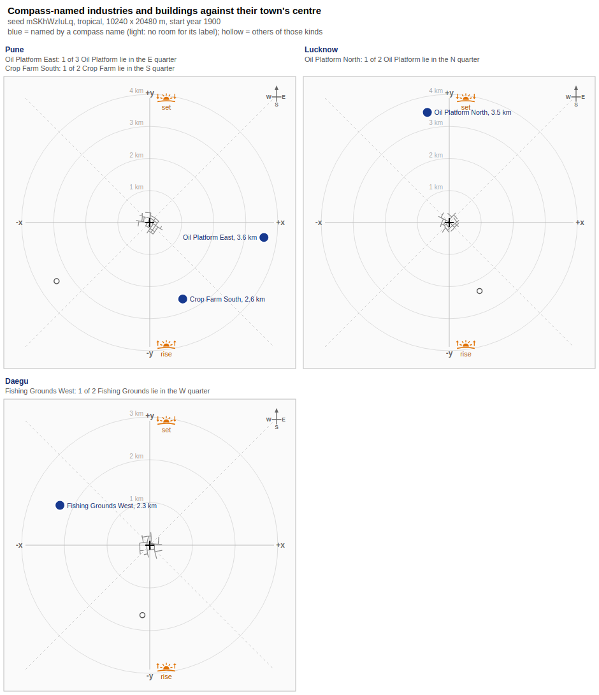
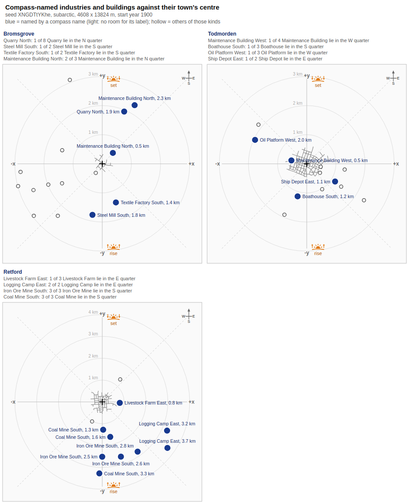
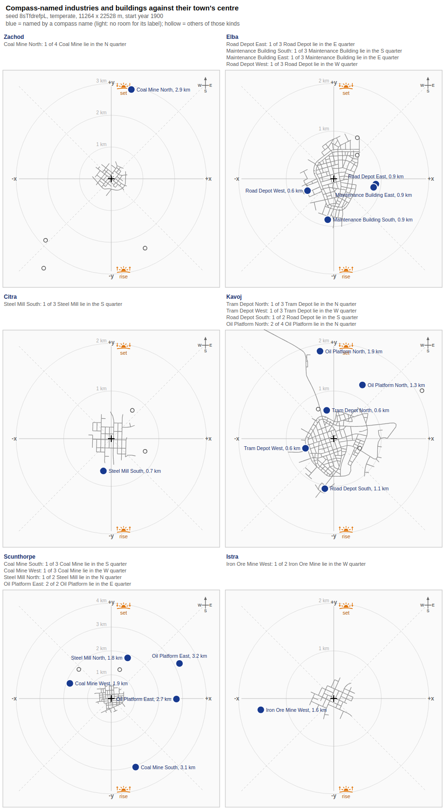

# Compass: which way north is

The save stores x and y and no compass. The game does use compass words, though: it puts one in the names of things it places near a town. Those words and the New Game preview agree that **x is east and y is north**; real-place editor maps do not count as evidence, because their authors turn them ([below](#real-place-maps-are-turned-by-their-authors)). The sun's path on the screen is a quarter turn off that frame. This repo draws pictures in the game's frame by default and keeps the sun's frame as an option.

Labels as in [README.md](README.md): Confirmed, Observed, Open. Everything here was read on 604.

## In short

- **Frame (Observed, 604).** The compass words in the names of things placed near a town fit x east and y north in all 31 of 31 cases in the best game, and no other frame fits more than 20; the New Game preview shows the same layout in two games. The save stores no compass, so this is the frame the repo draws in.
- **Real-place maps (Observed, 11 maps): no signal.** Their authors turn them, so they neither confirm nor refute the frame.
- **The sun (Observed, 604, two games).** On the screen the sun stands towards -y at Morning, +x at Day and +y at Evening, a quarter turn off the frame above. The noon heading is known to about 20 degrees.
- **Open.** When a name takes `#1` instead of a word, which point the words are judged from, the sun's hemisphere and how the game traces its path, and whether a mod could turn it (untested).

## What the repo draws

[terrain_map.py](../tools/terrain_map.py) takes `--north game|sun`:

| `--north` | Image up | Image right | Why |
|---|---|---|---|
| `game` (default) | +y | +x | the frame the name words use (below), the New Game preview |
| `sun` | +x | -y | the sun's path (below), the picture the repo drew before 2026-10-12 |

Other notes written before that date may give a direction with the sun's axes; where one does, it names the axis. [industry_compass.py](../tools/industry_compass.py) draws in the game's frame only.

## The compass words in names

**Rule (Observed, three games).** An industry placed near a town is named `<Town> <Kind>`. A second one of the same kind near that town is named `<Town> <Kind> #1` or `<Town> <Kind> North` (South, East, West). The player's own maintenance buildings, ship depots and boathouses follow the same pattern. The word is the direction in which the new thing lies from the town's centre, judged by the larger of the two offsets.

What the words do not settle (the games are those of the [test table](#the-name-word-test-604)):

- **When `#1` is used instead of a word (Open).** In the first game a second industry of a kind took `#1` when it lay in the same quarter as the first (Pune's `oil_platform`s and `forest`s, Caloocan's `livestock_farm`s) and a word when its quarter was new. Two pairs broke that: Bangkok's two `farm`s (north and east of the town) and two `oil_refinery`s (east and west) both got `#1`. Distance, order of creation and which town was nearest at the time are untested.
- **The town's centre (Open).** The word is judged from a point the save does not name. The cluster mean used here fits every name in a new game, which is a sign it is near it, not that it is the same point. The name label's anchor gives a measured centre ([town-centre.md](town-centre.md)); the names have not been judged from it yet.

## The sun's path is a quarter turn off

**Observed (604, two games).** With the camera held still, the Time of Day slider moves shadows so that the sun stands towards -y at Morning, +x at Day and +y at Evening (readings in the [evidence](#the-sun-subarctic-game) below). In the game's frame that is a sun that rises in the south, stands in the east at noon and sets in the north. The name words, the preview and the map all say otherwise, so the sun is the odd one out: an oddity in the game's lighting, not a property of the saves. Nothing here says how it came about. The plots mark it with the sunrise and sunset icons in [tools/icons/](../tools/icons/) (at -y and +y).

**Open.** The sun's hemisphere (a noon sun at +x fits north with a southern-style path or south with a northern one) and a few degrees of misalignment. The noon sun looked nearly overhead in the temperate game in February, so the shadows do not say which side of overhead it stands. A tropical series was not made. **Open: how the game traces the sun's path.** The heading of the noon sun is known only to about 20 degrees (at +x, above), and nothing found says how the game derives the path, so a finer figure should not be taken from elsewhere without a test of ours. A later test could read the noon heading more closely with roads: paused, camera held still, a road drawn along the shadow of a tall object at Day and at the two stops either side, then read with [street_edges.py](../tools/street_edges.py) as in the subarctic test. Repeating it in a second climate and at another date would show whether the heading moves with either. The camera facing of a new game was reported by the player as west and not checked against the axes (the temperate series above took its facing from the terrain).

**Open idea: turn the sun with a mod.** Untested; read from the install's files on 12 October 2026 (the version was not recorded). The modding API has a number `atmosphere.sunRotation` on the `Environment` record (`api/tealdef/api/type.d.tl`), read and written from the GUI thread with `api.gui.rendering.getEnvironment` and `setEnvironment`; the game's own cloud-coverage slider (`gui/game_bar/game_bar_widgets.tl` in `base/content/gui.zip`) uses the same pair. The four climate environment files (`climates/<climate>/<climate>.env.lua` in `base/content/climates.zip`) set `latitude` and `dayOfYear` but no rotation, so there is no config or Lua value to edit. The tealdef says `setEnvironment` does not persist, so a mod would have to reapply it, for example from a game script's `guiUpdateScript`. Not known: what the number rotates, its unit (radians or degrees), its sign, and whether the engine overrides it. A test would set it in steps and watch shadows with the Time of Day slider, camera held still. A rotation cannot mirror the path: a quarter turn that puts Morning in the east would put Day in the north and Evening in the west, a southern-hemisphere sky under northern latitudes.

## Evidence and tests

### The name-word test (604)

**Test.** [industry_compass.py](../tools/industry_compass.py) lists every name with a compass word, finds the same-kind industries or buildings nearest that town, and counts how many lie in the quarter the word names. It does that for the eight ways of laying east and north on x and y (four turns, each mirrored or not). The save keeps no town position (an [open gap](gaps/towns-and-buildings.md)), so a town's centre is the mean of the end points of its `town_*` street edges, one connected group per town. Which group is which town comes from the industries' names. An industry's position is the origin of its main model ([models.md](models.md)). The name table does not say which instance carries a name, so the test asks whether a candidate lies in the quarter, not which one it is.

| Game | Names with a word | Game frame (x east, y north) | Next best frame | Sun frame (north +x, east -y) |
|---|---|---|---|---|
| Large tropical, seed `mSKhWzIuLq`, new game, 8 towns, 29 industries ([part of the test games](test-games.md#large-tropical-game)) | 4 | 4 have a candidate in the quarter, all four exactly one | 3 (x east, y south, and x west, y north) | 1 |
| Small subarctic, seed `XNGDTtYKhe`, played to 1 April 1920, 3 towns, 86 industries and 16 depots and boathouses ([the Small subarctic game](test-games.md#small-subarctic-game)) | 24 | 24, eight with exactly one | 16 (x east, y south, and x west, y north) | 7 |
| Temperate, 1:2, towns Scattered, industry Packed, seed `8sTfdrefpL`, catalog save [6425796](https://mod.io/g/transportfever3/m/mynewsavenotfinished1) re-saved at 18 February 1937, 15 towns, 234 industries and depots ([catalog games we re-saved](test-games.md#catalog-games-we-re-saved)) | 31 | 31, sixteen with exactly one | 20 (x east, y south, and x west, y north) | 13 |

The remaining four frames scored 6 to 8 in the second game, 0 to 2 in the first and 9 to 13 in the third. The mirrors that keep one axis fit about two thirds of the names, because a candidate often sits where both frames agree. Only the game's frame fits all of them (in the third game 31 of 31, against 20 for the next best). **Observed**: the compass words are taken with x east and y north.

The first game's four names, one picture per town: blue dots are the industries the names point at, hollow ones the other same-kind industries near the town. Orange icons mark where the sun stands at Morning and Evening on the screen (below).

The second game, the four surest names of each of its three towns (of 24 names; exactly one same-kind candidate in the quarter first, then fewer there, then more rivals outside it). A light blue dot had no room for its label. In a played game the centre drifts as the town grows, and a name was fixed when its thing was placed, so the fit there is looser than in a new game.

The third game, six of its 11 towns with a compass name, the four surest names of each (31 names in all; 14 more end in a word but name a station, port or `rail_depot`, kinds the script does not list). Every one of the 31 has a candidate in its quarter. This game's depots and maintenance buildings stand close to their towns, so their labels crowd the street map.

### Other signals

- **The New Game preview (Observed, two games).** In the preview, x runs to the right and y up the screen. In the Large tropical game the eight town icons sat within 10 pixels of where the street groups put the towns at 39 m per pixel. The Medium dry game (seed `nDhSseN3R8`) was matched by a river and a lake and gave the same layout.
- **Real-place maps (Observed, 11 maps): no signal.** An editor map of a real place may be laid on the grid at any angle, so it can neither confirm nor refute the frame ([next section](#real-place-maps-are-turned-by-their-authors)).

### Real-place maps are turned by their authors

**Observed, 11 mod.io editor maps, all 604.** Each map's coast, rivers and lakes were read by eye against the real place, north-up or turned back until they matched, with no mirroring in any of them. The turn is the map's real north, measured clockwise from image up; "about" marks an angle taken by eye. Scale is the real length of one feature over its length on the map, also by eye (a dash: not measured).

| Mod | Place | Map size (m) | Real north is | Scale |
|---|---|---|---|---|
| 6426561 | Seattle | 16,384 x 49,152 | up | - |
| 6432283 | Akureyri and Eyjafjörður | 20,480 x 40,960 | up | about 1 : 1.5 |
| 6444410 | South Korea | 20,480 x 40,960 | up | about 1 : 15 |
| 6446060 | Sakhalin | 11,264 x 22,528 | up | about 1 : 48 |
| 6443296 | Japan | 28,672 square | up | about 1 : 50 |
| 6437731 | Iberia | 28,672 square | up | about 1 : 47 |
| 6450186 | Adelaide | 28,672 square | up | about 1 : 4 |
| 6436671 | South-West Ontario | 20,480 x 40,960 | right (about 90 degrees) | about 1 : 10 to 1 : 20 |
| 6436908 | Sudeste coast of Brazil | 13,824 x 41,472 | about 110 degrees clockwise | - |
| 6447883 | Long Island | 20,480 x 40,960 | left (about 270 degrees) | about 1 : 6 |
| 6440244 | Continental USA | 20,480 x 40,960 | left (270 degrees) | about 1 : 110 |

- **Turned to fit the strip (Observed, 11 maps).** The seven maps whose place runs along the long side of the picture, or is square, are north-up. The four strips turned (Ontario, Brazil, Long Island, the USA) hold a place that is wider than tall or runs on a diagonal, which a turn lays along the long side. Both senses occur, a quarter turn either way and one of about 110 degrees. That the author turned them to fit is a reading of the pattern; only the authors can confirm it.
- **Scale is the author's too (Observed).** Whole countries sit near 1 : 50, an area such as Adelaide or Long Island between 1 : 4 and 1 : 6, a fjord near true size, the USA at about 1 : 110. Heights and water are also edited: the Japan and USA maps keep a sloping sea floor, while the Akureyri fjord and the Great Lakes of the Ontario and USA maps are flat at the one water level.
- **Who made them (Open).** That the authors turn real elevation data into a heightmap, and trace or adjust the water, is an account of common practice, not read from a save. The save holds only the finished height grid.

### The sun, subarctic game

**Observed, Small subarctic game, 1 April 1920.** With the camera held still, the Time of Day slider moved the shadows of lamp posts and trees across the screen: to the left at Morning, towards the camera at Day, to the right at Evening, and in between at the stops between. The player drew a 139 m town road and a 140 m country road for the test ([street_edges.py](../tools/street_edges.py) `--diff` of the two saves); they lie 74.7 and -71.8 degrees from +x, and where they lie against each other shows that the camera looked along +x with -y at screen right. So the sun stands towards -y in the morning, towards +x at noon and towards +y in the evening: the angle grows (anticlockwise seen from above) and noon is on the x axis. Roads drawn to point at the Morning and Evening sun came out at 255 and 108 degrees, 19 and 18 degrees off the ends of that arc, which is what pointing by eye gives. Oblique screenshots of a station and a depot in a temperate game (Poole, 1900) agree to about 25 degrees.

### The sun, temperate game

**Observed, temperate game, 18 February 1937 (a re-save of catalog game 6425796).** Top-down screenshots of one coal mine, the game paused and the camera held still, with the Time of Day slider moved in seven steps from before Morning to past Evening. A terrain map of the place ([terrain_map.py](../tools/terrain_map.py)) puts the lake south-east of the mine; on the screen it lay at the upper left, so the picture was the map turned half a turn: screen top was -y (the camera looked south, towards the town the mine is named for) and screen left was +x. The oblique shots agree, with that town's labels at the far edge, and at Morning the sun's glare lay on the lake straight ahead of the camera (towards -y) while the shadows fell towards the camera. Read from the shadows of two lone trees, to about 20 degrees:
- before Morning: long, to the lower left of the screen (sun towards -y and -x);
- Morning: straight down the screen (sun at -y, a few degrees towards -x);
- just before Day: short, down and a little to the right (sun at -y, a little towards +x);
- at Day and just past it: too short to see (sun nearly overhead);
- Evening: long, up the screen and leaning left (sun at +y, leaning towards -x).

That is the arc of the subarctic test, Morning at -y and Evening at +y. Unlike the Poole shots, this is a full top-down series with the camera's facing known from the terrain.
