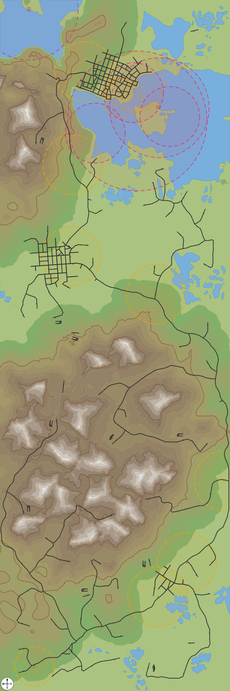

# Sample: a Small subarctic map as a vector SVG

[terrain-map-vector-small-subarctic.svg](terrain-map-vector-small-subarctic.svg) is the whole of one of our own test saves (format 604, Small 1 : 3, 4608 x 13824 m), drawn by [terrain_map.py](../../tools/terrain_map.py) with the default vector terrain (coloured height bands, water, height lines), the street-edge table's roads and rails at their template widths, the maintenance and depot buildings with their coverage circles, each industry as a badge (a white disc 96 m across with a grey border and its icon from [tools/icons/industries/](../../tools/icons/industries), at the origin of its main model; zoom in to see them), and a compass rose lower left. Open it in a browser: every layer is a `g.layer` that a page script or an editor such as Inkscape can toggle, and it is 0.6 MB, where the same map drawn with the terrain as an embedded PNG came to about 9 MB.

The dashed circles are each building's maintenance catchment: the radius is the one in the building's script in the game install, not a value read from the save; two trucks 319 m and 504 m from one building were listed under it as the 600 m circle says, and the edge itself is untested ([models.md](../models.md#road-maintenance-buildings-and-depots-origin-facing-footprint-and-coverage)).

Made with `terrain_map.py OUT_DIR SAVE.sav --depots --coverage --industries` and no other options, at commit `fc9912b`. What each option and layer does is in [tools/README.md](../../tools/README.md) and the script's docstring; how the terrain and heightmap are read is in [terrain.md](../terrain.md#drawing-the-map), and the compass rose and `--north` in [compass.md](../compass.md).

